<picture>
  <source media="(max-width: 600px) and (prefers-color-scheme: dark)" srcset="assets/neofetch-mobile-dark.svg" />
  <source media="(max-width: 600px)" srcset="assets/neofetch-mobile-light.svg" />
  <source media="(prefers-color-scheme: dark)" srcset="assets/neofetch-dark.svg" />
  
</picture>

<samp>Entre a análise matemática e o funcionamento dos computadores.</samp>

<samp>
<a href="https://www.linkedin.com/in/luiz-felipe-pereira-bandeira-8a51761b6/">linkedin</a> ·
<a href="https://codeforces.com/profile/root.svp">codeforces</a> ·
<a href="https://github.com/luizfelipejs/atlas-pdf">atlas-pdf</a> ·
<a href="https://github.com/luizfelipejs/modelagem">modelagem</a>
</samp>
