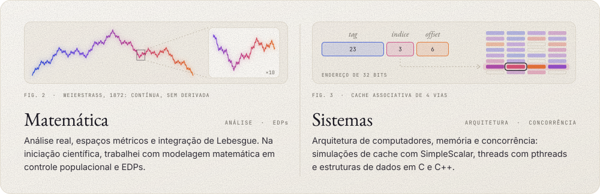
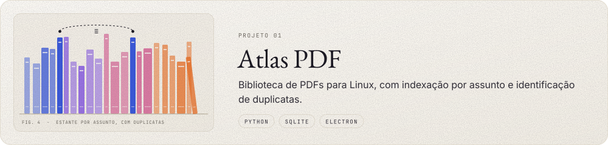
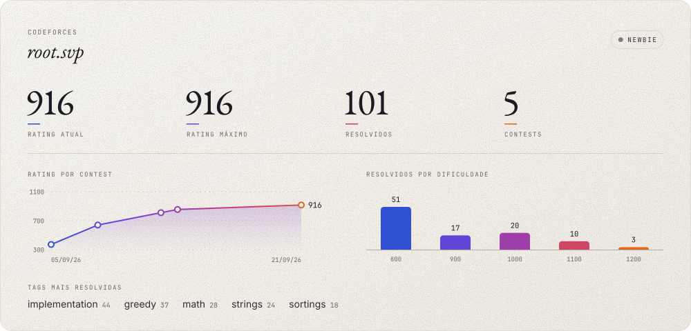

<picture>
  <source media="(max-width: 600px) and (prefers-color-scheme: dark)" srcset="assets/profile-mobile-dark.svg" />
  <source media="(max-width: 600px)" srcset="assets/profile-mobile-light.svg" />
  <source media="(prefers-color-scheme: dark)" srcset="assets/profile-dark.svg" />
  
</picture>

Entre a **análise matemática** e o funcionamento dos computadores. Estudo Ciência da Computação na UFPel, em Pelotas (RS), e programo principalmente em **C, C++ e Python**.

<a href="https://www.linkedin.com/in/luiz-felipe-pereira-bandeira-8a51761b6/"><picture><source media="(prefers-color-scheme: dark)" srcset="assets/link-linkedin-dark.svg" /></picture></a>
<a href="https://codeforces.com/profile/root.svp"><picture><source media="(prefers-color-scheme: dark)" srcset="assets/link-codeforces-dark.svg" /></picture></a>
<a href="https://github.com/luizfelipejs/livros"><picture><source media="(prefers-color-scheme: dark)" srcset="assets/link-livros-dark.svg" /></picture></a>

 

<picture>
  <source media="(prefers-color-scheme: dark)" srcset="assets/section-1-dark.svg" />
  
</picture>

<picture>
  <source media="(max-width: 600px) and (prefers-color-scheme: dark)" srcset="assets/interests-mobile-dark.svg" />
  <source media="(max-width: 600px)" srcset="assets/interests-mobile-light.svg" />
  <source media="(prefers-color-scheme: dark)" srcset="assets/interests-dark.svg" />
  
</picture>

<picture>
  <source media="(prefers-color-scheme: dark)" srcset="assets/section-2-dark.svg" />
  
</picture>

<picture>
  <source media="(max-width: 600px) and (prefers-color-scheme: dark)" srcset="assets/project-atlas-mobile-dark.svg" />
  <source media="(max-width: 600px)" srcset="assets/project-atlas-mobile-light.svg" />
  <source media="(prefers-color-scheme: dark)" srcset="assets/project-atlas-dark.svg" />
  
</picture>

<a href="https://github.com/luizfelipejs/modelagem">
<picture>
  <source media="(max-width: 600px) and (prefers-color-scheme: dark)" srcset="assets/project-modelagem-mobile-dark.svg" />
  <source media="(max-width: 600px)" srcset="assets/project-modelagem-mobile-light.svg" />
  <source media="(prefers-color-scheme: dark)" srcset="assets/project-modelagem-dark.svg" />
  
</picture>
</a>

<picture>
  <source media="(prefers-color-scheme: dark)" srcset="assets/section-3-dark.svg" />
  
</picture>

Treino no Codeforces como **root.svp** e no AtCoder, principalmente em C++ e Python.

Estatísticas no Codeforces

 

<a href="https://codeforces.com/profile/root.svp">
  <picture>
    <source media="(max-width: 600px) and (prefers-color-scheme: dark)" srcset="assets/codeforces-mobile-dark.svg" />
    <source media="(max-width: 600px)" srcset="assets/codeforces-mobile-light.svg" />
    <source media="(prefers-color-scheme: dark)" srcset="assets/codeforces-dark.svg" />
    
  </picture>
</a>

---

Linux · Bash · LaTeX &nbsp; / &nbsp; Pelotas, RS
