<picture>
  <source media="(prefers-color-scheme: dark)" srcset="assets/header-dark.svg" />
  
</picture>

Estudo Ciência da Computação na UFPel, em Pelotas (RS). Gosto de matemática, principalmente análise, de arquitetura de computadores e de sistemas operacionais: memória, cache, threads, concorrência. Programo mais em C, C++ e Python.

<p>
  <a href="https://www.linkedin.com/in/luiz-felipe-pereira-bandeira-8a51761b6/"></a>
  <a href="https://codeforces.com/profile/root.svp"></a>
</p>

## Análise real

Ando estudando análise real: sequências e séries, topologia da reta, continuidade, derivada, integral de Riemann e, a partir daí, análise no ℝⁿ, espaços métricos e integral de Lebesgue.

Na estante: *Curso de Análise* e *Espaços Métricos* (Elon Lages Lima), *Understanding Analysis* (Abbott), *Mathematical Analysis* (Zorich), *Real Analysis* (Folland), o Bartle sobre integral de Lebesgue e o *Counterexamples in Analysis*, cheio de funções que quebram a intuição. A de Weierstrass é a mais famosa delas:

<picture>
  <source media="(prefers-color-scheme: dark)" srcset="assets/weierstrass-dark.svg" />
  
</picture>

## Função zeta

A função zeta junta teoria dos números e análise. Para $`s`$ real maior que 1 ela é uma série convergente, e o produto de Euler liga essa série aos números primos:

```math
\zeta(s) = \sum_{n=1}^{\infty} \frac{1}{n^s} = \prod_{p\ \text{primo}} \frac{1}{1 - p^{-s}}, \qquad \zeta(2) = \frac{\pi^2}{6}
```

Estendida ao plano complexo, ζ leva a reta $`\operatorname{Re}(s) = \tfrac{1}{2}`$ neste desenho:

<picture>
  <source media="(prefers-color-scheme: dark)" srcset="assets/zeta-dark.svg" />
  
</picture>

## Pesquisa

- Na iniciação científica, trabalhei no projeto *Modelagem matemática em controle populacional*, estudando EDPs elípticas e parabólicas e métodos de perturbação.
- Simulei em Python o oscilador fracamente amortecido $`\ddot{x} + 2\varepsilon\dot{x} + x = 0`$ e comparei o método das médias e o de escalas múltiplas com a solução exata. O tema virou o trabalho *Análise assintótica de um oscilador massa-mola fracamente amortecido sob diferentes forçantes*, que preparei para o CIC. É a curva do cabeçalho.
- Montei slides sobre espaços de Banach, dual e bidual para as reuniões de análise funcional.

## Arquitetura e sistemas

- **Cache:** com o SimpleScalar, medi como cache unificada ou separada, associatividade, política de substituição (LRU, FIFO, aleatória), tamanho de bloco e uma L2 mudam o número de misses nos benchmarks do gcc e do ijpeg. Um script em Python automatizou as execuções.
- **Sistemas operacionais:** threads com pthreads, mutex, barreiras e o jantar dos filósofos.
- **C e C++:** implementei do zero estruturas como árvore binária de busca e tabela hash.

## Programação competitiva

Treino no Codeforces e no AtCoder, quase sempre em C++ ou Python.

<a href="https://codeforces.com/profile/root.svp">
  <picture>
    <source media="(prefers-color-scheme: dark)" srcset="assets/codeforces-dark.svg" />
    
  </picture>
</a>

<sub>O card se atualiza sozinho uma vez por dia com a API do Codeforces.</sub>

## Projetos

<table>
  <tr>
    <td width="50%" valign="top">
      <h3>Librarian</h3>
      <p><code>C++17</code> <code>Qt5</code> <code>SQLite</code></p>
      <p>App nativo onde minha biblioteca de PDFs vira um salão para andar, com uma estante por assunto, busca, favoritos e notas. Tudo desenhado com QPainter, com colisão e câmera.</p>
    </td>
    <td width="50%" valign="top">
      <h3>Atlas PDF</h3>
      <p><code>Python</code> <code>SQLite</code> <code>Electron</code></p>
      <p>Biblioteca de PDFs para Linux. Indexa os arquivos, separa por assunto e encontra duplicatas.</p>
    </td>
  </tr>
</table>

No GitHub:

- [modelagem](https://github.com/luizfelipejs/modelagem): equações diferenciais (mapa logístico, caos) e modelos estatísticos em Python.
- [livros](https://github.com/luizfelipejs/livros): materiais de estudo de matemática.
- [Twitter-webscrapping](https://github.com/luizfelipejs/Twitter-webscrapping): busca termos no X/Twitter com Python e Selenium e salva os textos em JSON.

## Ferramentas


## Contato

Se quiser conversar sobre matemática, arquitetura de computadores ou programação, me chama no [LinkedIn](https://www.linkedin.com/in/luiz-felipe-pereira-bandeira-8a51761b6/).
